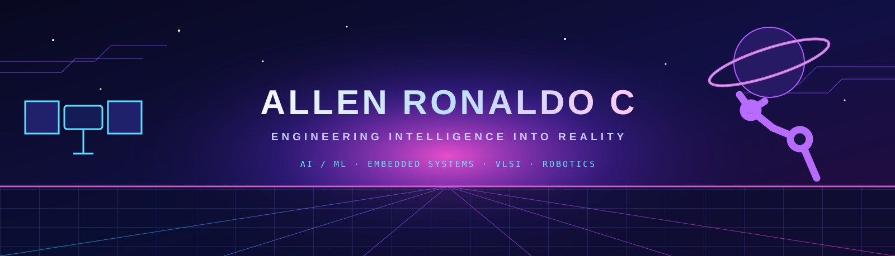

 

  

  

---

## ABOUT ME

I'm an **Electronics and Communication Engineering student at R.M.K. College of Engineering and Technology**, interested in building intelligent systems where hardware and software meet.

- Studying and building across **AI/ML, Embedded Systems, VLSI, IoT, Robotics, Computer Vision and Software Development**.
- Presented and published research at **IEEE CICT 2025** on energy-conscious ASIC implementations of LFSR models for IoT applications.
- Internship experience at **ISRO** and **Entudio**.
- I enjoy turning concepts into working prototypes — from sensors and edge devices to intelligent applications.

## WHAT I'M INTO

<table>
<tr>
<td width="50%" valign="top">

**AI / MACHINE LEARNING**

Deep learning · Computer vision · Intelligent applications

**EMBEDDED / IoT**

Connected devices · Sensor systems · Edge applications

</td>
<td width="50%" valign="top">

**VLSI / DIGITAL DESIGN**

RTL design · LFSR architectures · ASIC implementation

**ROBOTICS / SOFTWARE**

Hardware-software integration · Python services · React applications

</td>
</tr>
</table>

## TECH STACK

**AI, ML & Computer Vision**

**Software & Web**

**Embedded, IoT & VLSI**

**Tools & Platforms**

---

## FEATURED PROJECTS

<table>
<tr>
<td width="50%" valign="top">

### [Digital Twin — Car Engine](https://github.com/Allen-Ronaldo-C/Digital_Twin_Carengine)

Python-based virtual car-engine model simulating engine parameters, operating scenarios, engine health, and maintenance estimates without physical sensors.

**Focus:** Python · NumPy · Simulation

</td>
<td width="50%" valign="top">

### [LifeLink](https://github.com/Allen-Ronaldo-C/Life_Link_new)

Healthcare-oriented project exploring a community emergency support platform, medical-profile context, monitoring concepts, and AI-assisted information support.

**Focus:** Healthcare Technology · AI

</td>
</tr>
<tr>
<td width="50%" valign="top">

### [Mechanical Parts Detection](https://github.com/Allen-Ronaldo-C/Solidworks_ai_hackathon)

YOLOv8 pipeline for detecting bolts, locating pins, nuts, and washers, with annotation conversion, model training, inference, and submission generation.

**Focus:** Python · YOLOv8 · Computer Vision

</td>
<td width="50%" valign="top">

### [DL Smart Surveillance](https://github.com/Allen-Ronaldo-C/Motion-Detection-using-ML)

Deep-learning surveillance system using YOLOv8, OpenCV, and Flask for live camera monitoring, motion-event snapshots, and a web dashboard.

**Focus:** YOLOv8 · OpenCV · Flask

</td>
</tr>
<tr>
<td width="50%" valign="top">

### [Access Granted Power](https://github.com/Allen-Ronaldo-C/Access-Granted-Power)

Embedded power-control concept using keypad-based password authentication to regulate access to a power supply.

**Focus:** Embedded Systems · Authentication · Hardware

</td>
<td width="50%" valign="top">

### [Spectra Guard](https://github.com/Allen-Ronaldo-C/Spectra_Gaurd)

Browser-security project focused on identifying and blocking phishing websites.

**Focus:** Web Security · Phishing Protection

</td>
</tr>
</table>

**More builds:** [Braion — AI Team Name Generator](https://github.com/Allen-Ronaldo-C/braion-team-name-generator) · [Crime CCTV Detection](https://github.com/Allen-Ronaldo-C/Crime_CCTV_Detection) · [Astra ChatBot](https://github.com/Allen-Ronaldo-C/Astra-ChatBot) · [All repositories](https://github.com/Allen-Ronaldo-C?tab=repositories)

## RESEARCH & PUBLICATION

### Energy-Conscious ASIC Implementation of LFSR Models for IoT Applications

**IEEE CICT 2025 · IIITDM Kancheepuram**

Studied energy-conscious ASIC implementations of four LFSR-related architectures for IoT applications:

- Fibonacci LFSR
- Galois LFSR
- CRC
- Additive Scrambler

**Implementation tools:** Synopsys VCS · Cadence RTL Compiler · Cadence Encounter · UMC 90 nm CMOS

## EXPERIENCE

| Organization | Experience |
|---|---|
| **ISRO** | Internship experience |
| **Entudio** | Internship experience |

---

## GITHUB STATISTICS

  

  

---

## CONNECT WITH ME

  

**Engineering ideas into intelligent systems.**

